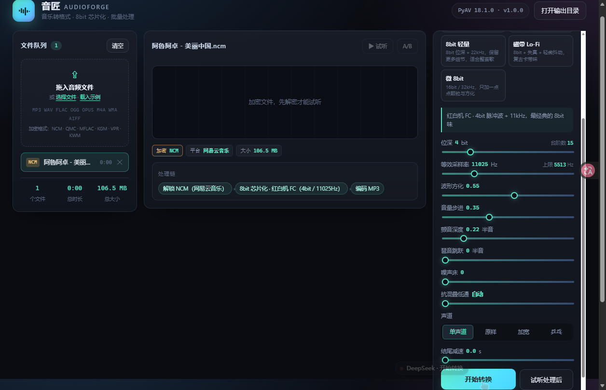

# AudioForge · 音匠

> A local music toolbox: **private-format decryption** + **format conversion** + **8-bit chiptune rendering** + batch processing, with an A/B listening console.



Pure Python on top of PyAV (bundled FFmpeg — no separate `ffmpeg.exe` needed).
Double-click `start.bat` on Windows and you are done.

---

## Quick start

| Task | How |
| --- | --- |
| Desktop app | Download `AudioForge.exe` from Releases, double-click |
| From source | `pip install -r requirements.txt` then `python launcher.py` |
| CLI | `python cli.py chip song.mp3 --preset nes -d out` |
| Preview first | Click **载入示例** in the UI, tune parameters, hit **试听处理后** |

Other options: `python launcher.py --port 8800` · `--no-browser` · `--host 0.0.0.0` (LAN sharing).

---

## 0. Private encrypted formats

NetEase / QQ Music / Kugou / Kuwo all ship encrypted containers that ordinary players and
converters cannot open. AudioForge decrypts them natively — **streaming, no re-encoding, zero
quality loss**.

| Platform | Formats | Algorithm |
| --- | --- | --- |
| NetEase Cloud | `.ncm` | AES-128-ECB unwraps an RC4 key → 256-byte S-box periodic XOR; metadata uses a second AES key |
| QQ Music v1 | `.qmc0 .qmc2 .qmc3 .qmcflac .qmcogg .qmcra` | 8×7 seed table + serpentine cursor produces a 0x8000-period mask, one skip per boundary |
| QQ Music v2 | `.mflac .mgg` | per-track `ekey` derivation; QTag trailer is parsed, an external ekey can be supplied |
| Kugou | `.kgm .kgma .vpr` | 16-byte header key + 272-entry dual mask tables + nibble swap; `.vpr` adds one more layer |
| Kuwo | `.kwm` | 1024-byte header holds a repeating 32-byte key; audio is XOR'd with a 32-byte period |

Measured on a real NCM (111 MB, 96 kHz FLAC):

```
111,698,478 bytes in  →  111,465,324 bytes FLAC out, 0.32 s
```

67× faster than the naive byte-by-byte version: the keystream repeats every 256 bytes, so it is
precomputed into a lookup table and applied with NumPy.

```bash
python cli.py unlock song.ncm -d out        # decrypt only
python cli.py chip song.ncm --preset nes    # decrypt + chiptune in one shot
```

`.mflac` / `.mgg` report a clear error when no usable ekey is present instead of emitting a broken file.

---

## 1. Format conversion (12 outputs)

| Format | Codec | Type | Notes |
| --- | --- | --- | --- |
| MP3 | libmp3lame | lossy | 64–512 kbps, best compatibility |
| WAV | PCM 16/24/32f | PCM | lossless, good for further processing |
| FLAC | flac | lossless | about half the size of WAV |
| OGG | Vorbis | lossy | beats MP3 at the same bitrate |
| OPUS | libopus | lossy | low bitrate, high quality |
| M4A | AAC | lossy | Apple ecosystem |
| ALAC | alac | lossless | Apple lossless |
| AIFF | PCM | PCM | Apple PCM |
| WMA | wmav2 | lossy | Windows Media |
| MP2 / AC-3 / CAF | — | compat | broadcast, video, CoreAudio |

Quality presets: **8-bit native / data saver / standard / high / studio**; bitrate, sample rate and
PCM bit depth can also be set individually.

---

## 2. 8-bit chiptune engine

Processing chain:

```
chip step effects → square-ify → sample-rate crush (zero-order hold) → bit-depth quantise
→ anti-alias lowpass → normalise
```

* **Bit depth** 1–16. 4-bit gives only 15 steps — that is the classic NES grit. Optional dither.
* **Effective sample rate** 1 kHz–44.1 kHz. 11 kHz is the NES flavour; 8 kHz is duller; 22 kHz keeps more detail.
* **Waveform squaring**: push sines toward square/pulse.
* **Volume stepping / gated tremolo**: emulates the 0/1/2/3-level volume envelope.
* **Vibrato, arpeggio, ring modulation**: NES vibrato/arpeggio, SID ring mod.
* **Noise bed**: envelope-gated white noise (the NES noise channel).
* **Anti-alias lowpass / stereo mode (mono · as-is · widen · ping-pong) / tape stop**.

Seven presets: NES / GameBoy / C64 (SID) / Arcade / 8-bit light / Tape Lo-Fi / Micro 8-bit.

---

## 3. Tuning

Volume (dB) · peak/RMS normalisation · speed 0.5–2.0× (phase vocoder, pitch preserved) ·
pitch shift ±12 semitones (duration preserved, error < 0.02 %) · 10-band EQ (±12 dB) ·
fade in/out · crop · auto trim silence · mono/stereo/swap · reverse.

---

## 4. UI

Drag-and-drop batch queue with per-file progress · waveform + spectrogram waterfall ·
A/B listening (first 12 s rendered on demand) · **one-click PNG comparison export** ·
live processing-chain preview · tag preservation and rewriting (ID3 / Vorbis / MP4 / FLAC).

---

## Build

```bash
python -m pip install -r requirements.txt pyinstaller
python -m PyInstaller AudioForge.spec --noconfirm
# → dist/AudioForge.exe
```

---

## Tech notes (the bugs that cost time)

1. **No ffmpeg.exe required** — PyAV bundles the shared libraries. Encoders disagree about sample formats and rates (Vorbis only takes `fltp`, Opus only 48 kHz), so parameters are negotiated and resampled before encoding.
2. **Ogg duration** — the bundled Vorbis encoder never backfills the last page's granulepos, so the container reports 1/16 of the real duration. `audio_io.fix_ogg_granule()` rewrites that page and recomputes the CRC.
3. **Vorbis is flagged experimental** — the encoder refuses to open without `-strict -2`.
4. **Never filter with a whole-file FFT** — circular convolution folds the tail into the head and the track sounds shifted. Windowed linear-phase FIR is used instead, with the order scaled to the cutoff.
5. **Speed/pitch use a phase vocoder** — WSOLA drifted 1–3 % in pitch; the STFT version keeps ±12 semitones within 0.02 %.
6. **Vectorise decryption** — byte-wise Python took 21.5 s for 111 MB; the 256-byte period turned it into a lookup table plus a NumPy XOR, now 0.32 s.
7. **QMC masks skip at boundaries** — one byte must be skipped every 0x8000 samples and the cursor reverses at `x<0` / `x>6`; copying the reference C++ exactly is the only way to align bit-for-bit.
8. **Decryption needs reversibility tests** — only NCM had a real sample, so the other three are verified by *pack → decrypt → byte-for-byte compare*, which is far stronger than checking magic bytes.
9. **Decoding must not trust `frame.time`** — Ogg/Vorbis emits negative or offset timestamps, so trimming is done by sample counting.

---

## Testing

```bash
python tests/test_core.py     # 34 tests: format round-trips, DSP, chiptune, pipeline, visualisation
python tests/test_api.py      # 15 tests: HTTP API, upload, jobs, path-traversal guards
python tests/test_unlock.py   # 22 tests: reversibility of all four decryptors + real NCM end-to-end
```

---

## License

GPL-3.0. See [LICENSE](LICENSE).

Decryption support exists so that files you own or are licensed to use remain playable in the
tools of your choice. Please respect the terms of service of each platform.
